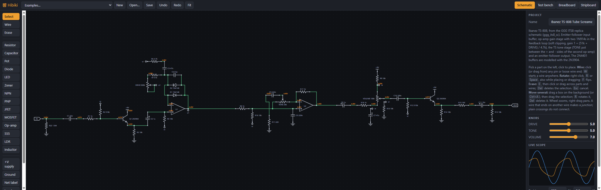
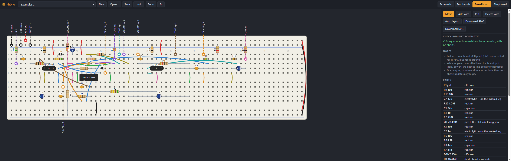

# Hibiki (響き): guitar pedal designer

Design a guitar effect pedal as a schematic, hear it on a real audio track, and get a breadboard (protoboard) and stripboard layout that is checked against the schematic. Runs in the browser, no install, no dependencies, works offline.

Start: double-click `index.html` (Chrome or Edge). The project autosaves in the browser; use Save / Open for `.json` files you want to keep or move. After the files change, reload the tab.

## What it does

Schematic tab: place parts from the left palette, wire them, edit values on the right. Parts: resistor, capacitor, inductor, pot, diode, zener, LED (red, orange, yellow, green, blue, white), NPN, PNP, N-JFET, N-MOSFET, op-amp, 555 timer, LDR, supply, ground, net label, input and output jacks.

- Wiring: click a pin or a loose wire end and then click where the wire should go, or drag from the pin; no tool change needed. `W` starts a wire anywhere (for example in the middle of another wire). A wire that ends on a pin or on another wire connects; wires that only cross do not.
- Net labels: every label with the same name is one net, as if wired together. Good for VREF and the supply. A label named `GND` or `+9V` acts as that symbol.
- Rotating: right-click a part, press `R` or `Space`, or use the small buttons that appear above the selected part (rotate, flip, delete). All of these also work while placing a part, while dragging it, and on a block before it is dropped. `F` flips.
- Moving several parts: drag a box on the empty background (or `Ctrl+A`), then drag the selection. `R` rotates the whole selection, `Del` deletes it.
- Erasing: the Erase tool (`E`), then click or drag across parts and wires. Or select something and press `Del`.
- `Esc` cancels, `Ctrl+Z` / `Ctrl+Y` undo and redo, wheel zooms, right-drag (or middle-drag) pans.

Live scope (right side of the schematic): every edit re-solves the circuit, shows the DC voltage of each net on the drawing (bias check), and plots a sine test tone in against out with the gain. Pots appear as sliders under Knobs.

Test bench tab: load any audio file the browser can decode (a clean, direct-recorded guitar works best) or use the built-in demo riff, choose start, length, guitar level in volts and oversampling, then Run. You get the input and output waveforms (overview plus a zoomable detail view with both overlaid), the spectrum of both, A/B playback (Dry / Pedal, optional loudness matching) and a WAV download of the processed sound.

Breadboard and Stripboard tabs: an automatic layout of the current schematic, with a parts list, track cuts and off-board wiring (pots, jacks, power). Drag any leg or wire end to another hole, add or delete wires, toggle track cuts (stripboard). The panel on the right compares the board with the schematic after every move and lists shorts, opens and doubled-up holes. Auto layout starts over; Download PNG / Download SVG save the drawing. A layout is kept while the schematic's connections stay the same (changing a value keeps it; rewiring regenerates it and discards hand edits).

## Special parts

- Zener: a diode model (1N4728A 3.3 V, 1N4733A 5.1 V, 1N4739A 9.1 V, 1N4742A 12 V). It regulates with its cathode on the positive side.
- MOSFET: N-channel only (IRFZ44N, 2N7000, BS170).
- LDR: set its dark and lit resistances and a light level from 0 to 1. Or type the ref of an LED in the circuit (for example `D1`) in "Lit by LED": the LDR then follows that LED's current, reaching the lit resistance at 20 mA, with the slow response of a real cell (about 3 ms to light up, 30 ms to recover). Measure your own LED and LDR pair and enter its two resistances.
- 555: trigger, threshold, discharge, output and control pins. Power and reset are implicit (highest supply and ground, reset tied high), like the op-amps. It is the only oscillator, so it is the LFO: 555, LED and LDR together make a tremolo.

## Examples menu

Small teaching circuits (my own drawings of classic topologies):

- Transistor booster, two-transistor fuzz (Fuzz Face topology), op-amp overdrive (soft clipping), op-amp distortion (hard clipping), JFET preamp.
- Optical tremolo (555 + LED + LDR) and optical compressor (op-amp with an LDR across its feedback resistor). Both are my own designs, simulated only, using values from my own parts inventory.

Full pedals read from published schematics:

- Sovtek Red Army Overdrive (first Russian Big Muff, 1990), Sovtek Big Muff (Civil War / Green Russian), Sovtek Big Muff (Black Russian). The three are the same architecture: they differ only in the feedback caps (430 pF, two 1 nF in series, 470 pF) and transistors.
- EHX Big Muff (Triangle, V1 1967), EHX Big Muff (Ram's Head "47", 1973), EHX Big Muff (V6, 1978-84, drawn without its tone-bypass switch).
- Orange Squeezer compressor (JFET), from the General Guitar Gadgets replica schematic. It needs 2N5457 JFETs. Its BIAS trimmer sets how hard it squeezes; below about 4 it chokes the signal.

The six Big Muffs above are from Kit Rae's traces at bigmuffpage.com and are generated by one template in `presets.js` (`bigMuff`), so another version is a few lines of values.

Full pedals from the General Guitar Gadgets schematics page (generalguitargadgets.com/how-to-build-it/technical-help/schematics/), each one's about text names the PDF it was read from:

- Boosters: EHX LPB-1, MXR Micro Amp, Orange treble-bass booster (germanium PNP, positive ground), Alembic Stratoblaster (JFET).
- Overdrive and distortion: Ibanez TS-808, Boss OD-1 and SD-1 (GGG's ITS8 versions), DOD 250, MXR Distortion+, Ross Distortion, ProCo RAT (GGG Rodent), Ibanez SD-9, Red Fuzz Distortion, Marshall Bluesbreaker, Marshall Guv'nor, EHX Big Muff late-70s third version (through the `bigMuff` template).
- Fuzz: EHX Muff Fuzz (transistor), Fuzz Face germanium, Fulltone '69, Tone Bender Mk II Professional, Tone Bender 3-knob, Supa Tone Bender, Jordan Bosstone, Shin-ei Companion Fuzz FY-2 (two NPN collector-feedback stages, both modelled as 2N3904 in place of the original C536F7G).
- Fuzz, not from GGG: ZVEX Fuzz Factory (2N3904 stage into a germanium PNP pair, negative ground), from M. Chittum's rev 1.1 trace and the PCBWay project schematic; connections and values cross-checked against the PedalPCB Fuzz Foundry schematic. Its 1M input resistor is not on the Fuzz Foundry drawing.
- Octave: Dan Armstrong Green Ringer, fOXX Tone Machine (octave switch on), Ampeg Scrambler (original schematic, effect switch on; its 2N5306 Darlingtons are modelled as single 2N5088s).
- Filter: Vox V847 wah (the pedal is a knob; 0 is toe down).

These are written as netlists in `pedals.js` and drawn automatically when loaded: signal path left to right, parts wired, grounds and supplies as symbols, and a net label on each end of any connection that would need a long wire. The drawing is checked against the netlist every time. Bypass switches, LED indicators and polarity diodes are left out. Germanium and positive-ground pedals run from a -9 V supply. Parts without a model use the nearest one: 2N5089 and MPSA18 as 2N5088, 2N4401 as 2N3904, BC546 as BC547, 2N5458 as 2N5457, TL061 and LF351 as TL071, OC76 / OC81D as OC44 / AC128, 1N270 as 1N34A, 2N5306 (Darlington) as a single 2N5088, BC169B as BC547, 1N456 as 1N4148. The germanium models have no leakage current, so the Tone Bender Mk II's first stage (biased by leakage on the real thing) sits nearly off in the simulation.

## Blocks

Blocks button (bottom of the palette, or `B`): opens a pop-up with every pre-wired group of parts. Type in the search bar to filter by name (for example `muff`, `fender`, `rat`), click one of the function tags (power, utility, gain, distortion, tone, dynamics, modulation) to filter by it, and switch between drawn previews and a plain list (the choice is remembered). Clicking a block, or `Enter` on the first match, closes the pop-up and the block follows the cursor until you click to drop it, with open wire ends for you to connect. `Esc` or right-click cancels; one undo removes the whole group.

- Power: half-supply bias (Vref divider for op-amps), polarity protection (1N5819) with filter caps, 5.1 V zener rail.
- Utility: input pulldown + coupling cap, output coupling cap + volume, op-amp follower, emitter follower.
- Gain: non-inverting op-amp stage, NPN stage (LPB-1 style), Rangemaster treble booster (germanium PNP).
- Distortion, clippers: diode pair to ground, asymmetric 2 + 1 diodes, and a diode pair to put across an op-amp feedback resistor. For LEDs, Schottky, germanium or zeners, drop one of these and change the diode model.
- Distortion, stages: Tube Screamer (soft clipping in the feedback loop), Distortion+ / DOD 250 and RAT (op-amp gain into diodes to ground), Big Muff stage (collector-feedback stage with diodes in the loop), Fuzz Face (two-transistor feedback pair), Fuzz Factory pair (the ZVEX example without its 2N3904 input stage, with its five knobs), Bazz Fuss (one transistor with a diode from collector to base), octave-up fuzz (gain stage, phase splitter and two Schottky diodes as a full-wave rectifier). These are the clipping stages only: add input, tone and volume blocks around them.
- Tone, pedal controls: RAT-style treble cut, James / Baxandall passive bass and treble, the AMZ "Stupidly Wonderful Tone Control" 1, 3 and 4, a Framus-style mid scoop, an active tilt EQ, a 2-pole Sallen-Key low-pass.
- Tone, Big Muff controls: stock, Ram's Head, Green Russian, Op-amp, and the three two-knob variants Hoof (mids), Musket (mids) and Pickle (scoop + voice).
- Tone, amp stacks: Fender blackface, Fender Bassman 5F6-A, Fender two-knob treble / bass, Marshall, Vox top boost, Hiwatt CP, Hiwatt DR, Sovtek MIG-60, Sovtek MIG-100H, Blackstar HT-5 (its ISF control is a dual pot, drawn as two knobs to move together), Dumble (rock setting).
- Tone, active EQs: Boss FZ-2 (bass / treble) and Boss HM-2 (Color Mix L / H, three gyrators).
- Dynamics: optical compressor (the example as a block), one-transistor optical limiter (a gain stage whose own output lights an LED on an LDR at its input), LED limiter (high gain into LEDs in the feedback loop: long sustain, but it is soft clipping, not clean compression).
- Modulation: 555 LFO driving an LED, and an LDR attenuator. Drop the LFO first and the attenuator links itself to that LED; together they are the tremolo.

Blocks with op-amps: wire every free resistor end (the status panel lists them as "not connected") to a Vref block, and feed the input through a coupling cap. The HM-2 block has a 1M input bias resistor added, because the original takes its bias from the stage before it.

## Where the values come from

Read directly from a source:

- Tonestack calculator project (tonestack.yuriturov.com, github.com/why-trv/yet-another-tonestack-calculator): stock Big Muff tone, Hoof, Musket, Pickle, both Hiwatts, both Sovtek stacks, both Boss EQs, Vox, James, SWTC 1 / 3 / 4, Framus mid, tilt, Bassman and two-knob Fender values, Blackstar HT-5, Dumble. All without that project's source resistance, load and output cap.
- Kit Rae's Big Muff traces (bigmuffpage.com): the six Big Muff examples, the Big Muff stage block, the Ram's Head tone block. The Green Russian tone block matches the trace.
- ElectroSmash analyses, read from the PDF mirror at electrosmash.mas-effects.com/pdf: Fuzz Face block (drawn as the negative-ground silicon version, 330 ohm where the germanium original has 470), RAT stage, Rangemaster.
- General Guitar Gadgets: Orange Squeezer and the 28 GGG pedals listed under Examples. The Guv'nor tone stack and the fOXX Tone Machine were read from small drawings (the Tone Machine at zoom); check those against the PDFs before building.

Deviations from those sources: the Bassman block uses the Marshall wiring already in Hibiki (mid pot as a variable resistor) where the tonestack project draws the mid cap on the mid pot wiper. The Vox bass pot is reversed so clockwise gives more bass. SWTC 2 is left out because its drawing is ambiguous. The Dumble has no volume pot or bright cap, and its bass pot is 250k instead of the 312k listed. The EHX V6 has no tone-bypass switch.

Matching several published sources but not read from one schematic: Tube Screamer stage, Distortion+ / DOD 250 stage.

From memory, not checked: Fender blackface, Marshall, Op-amp Big Muff tone, Bazz Fuss, LPB-1 style NPN stage.

My own designs or textbook circuits with values I chose: optical compressor, tremolo, LFO, both limiters, octave-up fuzz (after the Green Ringer idea; in simulation the second harmonic is more than ten times the fundamental), buffers, clippers, power blocks, Sallen-Key filter.

Things to keep in mind: pot directions (which way is "more") were chosen by me, flip a pot if one feels backwards. The simulator's op-amps are ideal, so the RAT's LM308 slew-rate character is not reproduced. The OC44 transistor model uses typical figures, not a fitted model.

## Files

- `index.html`: page and styles.
- `app.js`: all UI (editor, block picker, scope, test bench, board views).
- `sim.js`: circuit simulator and device model tables.
- `schem.js`: part definitions and symbols, net extraction, conversion to simulator netlist and to physical parts.
- `layout.js`: automatic breadboard / stripboard placement and the layout-versus-schematic checker.
- `presets.js`: the example circuits (`RAW`, plus the `bigMuff` template) and the blocks (`BLOCKS`).
- `pedals.js`: example pedals written as netlists, one part per line (format at the top of the file). Easier to type from a schematic than grid coordinates.
- `EXAMPLES.md`: how to add an example pedal, step by step (netlist format, rules, checks). Written so that a person or an AI model can follow it.
- `mcp.js`: MCP server so Claude can design and test pedals with this engine; `MCP.md` is its guide. Projects it works on live in `projects/`.
- `test.js`: self-check. Run `node test.js` after touching `sim.js`, `schem.js`, `layout.js`, `presets.js`, `pedals.js` or `mcp.js`.

No build step. The non-UI files also load in node, which is how the tests run.

## Designing with Claude (MCP)

`mcp.js` is an MCP server for Claude Code (setup in `MCP.md`). Once registered, in any new Claude Code session you can ask for a pedal in words; Claude writes the circuit as a netlist, checks bias, gain, distortion and frequency response with the simulator, can run a WAV through it, gets the board layouts, and opens the result in the browser. Opened that way, the browser and Claude share the same project file: your edits are saved to it and Claude's edits appear in the page within about 2 seconds. Details, the netlist format and a worked example are in `MCP.md`.

## How the simulation works

Modified nodal analysis solved per sample with Newton-Raphson (dense Gaussian elimination, the matrices are small). Capacitors and inductors use a slightly damped trapezoidal rule (theta = 0.55). Diodes use the Shockley equation, with a second shifted junction for zener breakdown. BJTs use the Ebers-Moll transport model, JFETs and MOSFETs the Shichman-Hodges square law (JFETs with gate diodes, MOSFETs with a body diode), all with SPICE-style junction voltage limiting. Op-amps are an ideal gain of 100 000 that switches to a fixed voltage when the output reaches a rail (so they clip like the real thing on 9 V), powered implicitly from the highest supply and ground. The 555 is a latch that is updated between samples from its trigger and threshold pins, driving its output and discharge pins. An LDR is a resistor whose value follows its light level, or the current of the LED it is linked to, with a lag. The run starts from the DC operating point, so there is no power-up thump. Audio is processed at 1x, 2x or 4x the file's sample rate.

Speed measured on this PC: about 0.2x to 0.4x real time for the small examples at 2x oversampling (8 s of audio in 1.5 to 3.5 s). The Big Muffs are larger and slower; not measured.

## Limits worth knowing

- Device models are DC-only typical values: no junction capacitance, no op-amp slew rate or bandwidth, no noise. Transistor gain, JFET pinch-off, MOSFET thresholds and germanium parts vary a lot in reality; enter your measured hFE on a transistor to see the real bias.
- Not cross-checked against LTspice. What is checked (`test.js`): divider, RC step response and corner frequency, RL corner, diode clipper level and symmetry, op-amp gain and rail clipping, zener voltage, MOSFET bias and switching, LDR values, 555 frequency and duty cycle, the tremolo rate and the compressor's gain reduction, plus bias, gain, convergence and both board layouts of every example, and wiring and 1 kHz gain of every block that has an input and an output.
- Nothing here has been built or listened to: the audio results are simulations.
- The 555 switches on sample boundaries: fine as an LFO, but an audio-rate 555 would alias.
- Oversampling uses linear interpolation and a plain average for decimation, so very hard clipping can still alias a little at 1x and 2x.
- The input jack is an ideal source unless you give it a source resistance / inductance (the fuzz example uses 7k, because that circuit depends on the pickup impedance).
- Part models follow my own parts inventory where it has an equivalent: 2N3904, 2N2222, 2N3906, BC557, LM741, LM358, NE5532, TL082, TL084, 1N4007, 1N5819, 1N4733A, IRFZ44N, NE555, the LED colours and an LDR. New NPNs default to 2N3904 and new op-amps to TL082. Quad op-amps (TL074, TL084, LM324) are laid out as DIP-14. LED, BC557, zener and MOSFET parameters are fitted to typical datasheet figures, not measured. The inventory has no JFETs, germanium transistors or germanium diodes, which the JFET preamp, Orange Squeezer, Rangemaster and Distortion+ blocks use.
- No chorus, delay or phaser chips, no OTA (so no Dyna Comp or Ross compressor), no P-channel MOSFETs, no true-bypass switch, one audio input and one output. Negative supplies work for transistors; op-amps assume ground as their lower rail unless a negative supply is drawn.
- Layouts are electrically verified but not optimised: the stripboard uses one strip per net, so a hand layout can be smaller. The breadboard assumes continuous power rails (some boards split them in the middle). A circuit wider than a full-size breadboard (63 columns) continues on a second board to the right, with jumpers joining the power rails. If the first breadboard pass leaves a part off, a second pass keeps spare holes in each strip and avoids laying parts across strips that are running out (the Guv'nor needed it).
- Transistor pin orders on the boards come from the model table in `sim.js` (`pins`). Manufacturers differ: check the datasheet of the part in your hand.

## Adding parts, examples and blocks

- A new diode, zener, transistor, JFET, MOSFET or op-amp model is one line in the tables at the top of `sim.js`.
- Step-by-step instructions for adding a pedal are in `EXAMPLES.md`. A new example circuit is one entry in `LIST` in `pedals.js` (a netlist, the quickest way) or in `RAW` in `presets.js` (grid coordinates, for a hand-drawn schematic). A `pedals.js` entry needs no test entry: it is checked for wiring, bias, convergence, a gain between 0.2 and 500 and both layouts. Add its expected gain range to `expectGain` in `test.js` and `node test.js` will catch a miswired one. Another Big Muff version is one `bigMuff(...)` call with its values.
- A new block is one entry in `BLOCKS` in `presets.js`, named `Category: name`; the category decides its function tag (`CORE`). Give it `io` (input and output points) and the test wires it up and simulates it; active blocks also list their `vref` points, and `gain` overrides the expected gain range.

## Not done yet

- General Guitar Gadgets schematics not added, and why: chorus, flanger, delay, echo and reverb units (BBD chips, not modelled); OTA compressors and filters (CA3080: Dyna Comp, Ross, CP10, DOD 280, envelope filters); Octavia and direct boxes (transformers); Phase 90, EA and Anderton tremolos (their LFOs are transistor or op-amp oscillators, which never start here because the simulation begins at the DC point with no noise; only the 555 works as an LFO); amps (LM384, LM386), switchers and power supplies (no switches or power ICs); Klon Centaur (needs its 18 V charge pump and a dual-gang gain pot; every op-amp in Hibiki shares one supply); Maestro FZ-1S (dual-gang balance pot and a switch I could not trace reliably); Bee Baa and Red Ranger (switch-dependent circuits); Guild Foxey Lady (a Triangle Big Muff with a tone resistor value missing from the drawing). Not looked at yet: Fuzz Face silicon and Fulltone '70, Easy Face, Hog's Foot, ColorSound bass fuzz, Krampus, Deluge, Adamu, Brass Master, Brown-Sound-In-A-Box, OC Dist, Fulldrive, other GGG Big Muff versions, Six Band Graphic EQ, Talk Box, Vox and Ibanez wahs other than the V847, cab simulator, the Boss factory scans.

- ElectroSmash PDFs already downloaded but not read: Boss DS-1, Marshall Guv'nor, Klon Centaur, MXR MicroAmp, MXR Dyna Comp, Tube Screamer, Distortion+, Big Muff Pi. Their text layer has no digits, so values must be read from the page images.
- More Big Muff versions on bigmuffpage.com (V3, op-amp V4 / V5, later reissues).
- No JHS schematics were found. The Pulp 'N' Peel is widely reported to be based on the Orange Squeezer (not confirmed here).
- DOD 280 compressor: only a board layout was found, not a schematic.
- No Sovtek pedal other than the Big Muff family, and no EHX pedal other than the Big Muffs.

## References

Each entry says whether the source was read directly or only seen as a search summary.

- Ho, Ruehli, Brennan (1975). The modified nodal approach to network analysis. IEEE Trans. Circuits and Systems 22(6). doi:10.1109/TCS.1975.1084079
- Nagel (1975). SPICE2: A Computer Program to Simulate Semiconductor Circuits. UCB/ERL M520.
- Yeh (2009). Digital Implementation of Musical Distortion Circuits by Analysis and Simulation. PhD thesis, Stanford.
- Yeh, Abel, Smith (2010). Automated Physical Modeling of Nonlinear Audio Circuits for Real-Time Audio Effects, Part I. IEEE TASLP 18(4). doi:10.1109/TASL.2009.2033978
- Yet Another Tonestack Calculator, github.com/why-trv/yet-another-tonestack-calculator and tonestack.yuriturov.com (read directly), and jatalahd/tsc, which it cites.
- Kit Rae, The Big Muff Page, bigmuffpage.com (read directly): schematics of the Red Army Overdrive 1st edition, version 7B / 7C Civil War and tall-font Green Russian, version 7C / 8 bubble-font and Black Russian, version 1 67#1, version 2 "47" Ram's Head, version 6.
- ElectroSmash analyses, PDF mirror at electrosmash.mas-effects.com/pdf (read directly): Fuzz Face, ProCo Rat, Dallas Rangemaster.
- General Guitar Gadgets, Shin Ei Companion Fuzz FY-2 schematic (ggg_secf_sc), version 2012January23 (read directly; https://generalguitargadgets.com/pdf/ggg_secf_sc.pdf).
- General Guitar Gadgets, OSQ (Dan Armstrong Orange Squeezer replica) schematic, version 2013June11 (read directly).
- General Guitar Gadgets (JD Sleep), Ampeg Scrambler Replica (Original Schematic), version 2014March06 (read directly; https://generalguitargadgets.com/pdf/ggg_scramb_sc_orig.pdf). The drawing shows Q4 with a PNP emitter arrow while its parts list says 2N5306 (NPN); the example follows the parts list.
- ZVEX Fuzz Factory: M. Chittum, rev 1.1 trace (solgrind.wordpress.com, 2008) and PCBWay "ZVEX - Fuzz Factory" project schematic (the example's stated sources); PedalPCB Fuzz Foundry build document, revision 11.04.17, docs.pedalpcb.com/project/FuzzFoundry.pdf (read directly, used as the cross-check); parts list in the comments of tagboardeffects.blogspot.com/2010/02/zvex-fuzz-factory.html.
- Found by web search and seen only as search summaries: eCircuit Center distortion box netlist; PedalPCB forum "Distortion 250 Parts Values"; General Guitar Gadgets RAT project; Elliott Sound Products Project 45; DIYstompboxes threads "Garbage Compactor" and "Simple optical compressor"; Effects Layouts "DOD 280 compressor" (page opened: it is a board layout).

## Licence and trademarks

Code: MIT licence, see `LICENSE`.

The example circuits are replicas for study, typed from published schematics and traces that are credited above; no schematic files are redistributed here. Product and company names (Electro-Harmonix, Ibanez, Boss, MXR, ProCo, Marshall, Vox, ZVEX, Ampeg and the others) are trademarks of their owners and are used only to say which circuit an example reproduces. This project is not affiliated with or endorsed by any of them.
